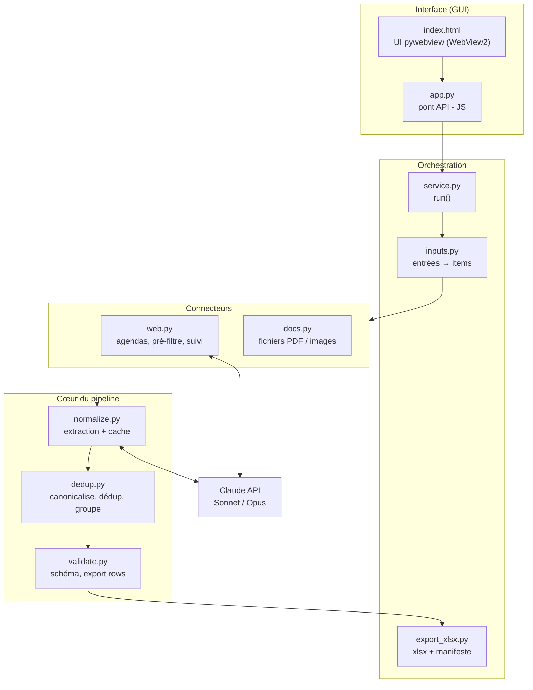
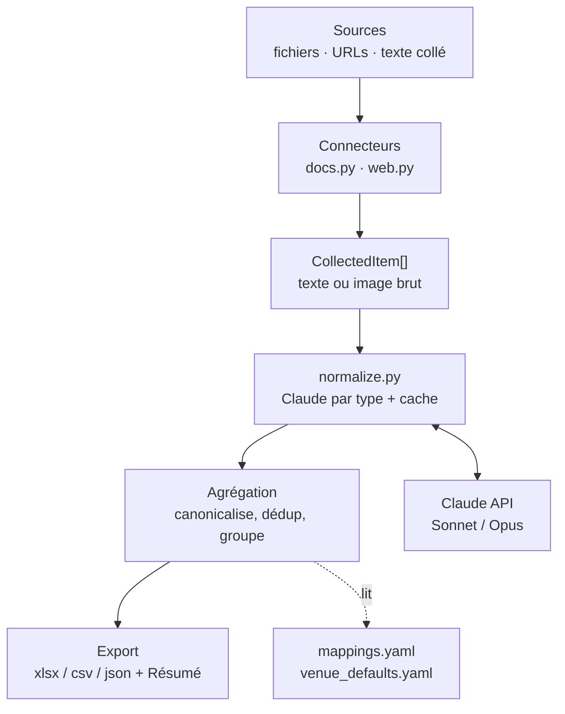
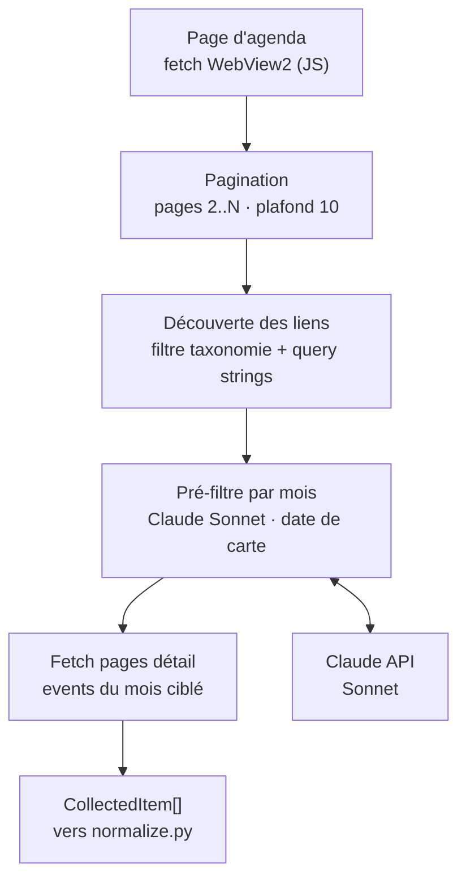

# Architecture de tapageur

`tapageur` est un pipeline d'extraction d'événements culturels (fanzine + radio
Le Bidul, Le Mans). Il collecte des sources hétérogènes (PDF, affiches, agendas
en ligne, texte collé), les fait normaliser par Claude, puis produit un fichier
au format du tableur « biduleur » (xlsx / CSV / JSON), via une interface
graphique (`tapageur-gui`, pywebview) ou en ligne de commande (`cli.py`).

## Vue d'ensemble (composants)

Les couches : l'application GUI (interface + orchestration), le moteur
d'extraction (connecteurs + cœur), et le service externe Claude.

- **Interface** : `index.html` (UI rendue par le navigateur embarqué WebView2)
  dialogue avec `app.py` (pont `window.pywebview.api.*`).
- **Orchestration** : `service.py` enchaîne collecte → pipeline → export.
  `inputs.py` transforme les entrées en `CollectedItem` ; `export_xlsx.py`
  écrit le xlsx (modes d'écriture + feuille cachée « manifeste »).
- **Connecteurs** : `web.py` (URLs d'agendas) et `docs.py` (fichiers).
- **Cœur** : `normalize.py` (appel modèle + cache), `dedup.py`
  (canonicalisation / dédoublonnage / groupement), `validate.py` (schéma et
  rendu des lignes du tableur).
- **Claude** : Sonnet pour le web / texte, Opus pour les PDF / images.

## Flux de données

Des sources jusqu'aux fichiers de sortie :

1. **Sources** — l'utilisateur fournit fichiers, URLs et texte (GUI ou CLI).
2. **Connecteurs** — chaque source devient un `CollectedItem` (texte extrait
   d'un PDF, image base64, texte d'une page web).
3. **Normalisation** — `normalize.py` envoie chaque item à Claude (cache par
   item indexé sur le contenu + `PROMPT_VERSION`), parse tolérant du JSON,
   filtre par mois, règles d'ancrage anti-confabulation. Sortie : des `Event`.
4. **Agrégation** — `dedup.py` canonicalise lieux / artistes / festivals (via
   `mappings.yaml`), applique les défauts par lieu (heure / prix / ville via
   `venue_defaults.yaml`), dédoublonne et groupe par festival / date / lieu.
5. **Export** — `export_xlsx.py` écrit le xlsx (modes Créer / Ajouter / Fusionner
   + manifeste des sources traitées), ainsi que CSV / JSON.

## Zoom : le connecteur web

Pour une URL d'agenda « à suivre », tout se passe **à l'intérieur de `web.py`**,
en amont de `normalize.py`. C'est là que vivent la **découverte des liens**
(gestion de la pagination, de la taxonomie et des query strings) et le
**pré-filtre par mois** (qui évite de télécharger les events hors de la cible).

- **Pagination** — suit les pages 2..N du même agenda (plafond 10) et unit la
  découverte des events, pour ne pas s'arrêter à la page 1.
- **Découverte des liens** (`_extract_subpages`) — quels events existent :
  on écarte les pages de taxonomie (catégories, tags…) et on canonise les URLs.
- **Pré-filtre par mois** (`_filter_event_urls` + `PREFILTER_SYSTEM`) — quels
  events valent le téléchargement : pour chaque lien, Claude lit la **date sur
  sa carte** d'agenda et ne garde que le mois + l'année ciblés (« pas de date
  lisible → inclure », pour ne jamais perdre un event).
- **Fetch pages détail** — seules les pages retenues sont téléchargées ; chacune
  devient un `CollectedItem` qui rejoint le flux commun.

> Les diagrammes ci-dessus sont en Mermaid : GitHub les rend automatiquement
> dans la page du fichier.
